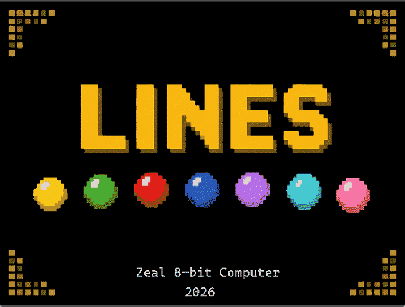
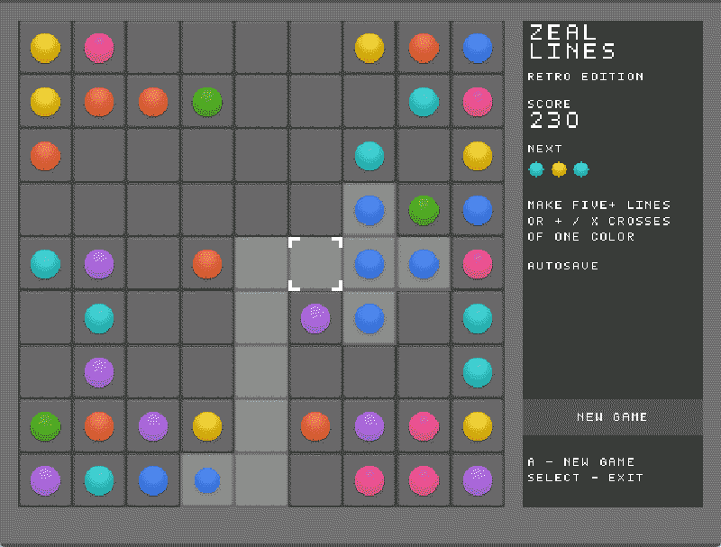

# zeal-lines

A Lines / Color Lines remake for the [Zeal 8-bit Computer](https://zeal8bit.com/),
built with the [Zeal Development Environment](https://github.com/zoul0813/zeal-dev-environment)
and the [Zeal Video Board SDK](https://github.com/Zeal8bit/Zeal-VideoBoard-SDK).

The game targets Zeal 8-bit OS and the Zeal Video Board in 640×480 4bpp mode.
It is a single-player game controlled by keyboard, SNES pad or SNES mouse.

## Screenshots
<table>
  <tr>
    <td></td>
    <td></td>
  </tr>
</table>

## Current state

Implemented:

- 9×9 board, 7 colors, 32×32 px balls;
- three-ball preview and spawn;
- line matches, direct “+” crosses and diagonal “X” crosses;
- free move after a match;
- autosave to `zeal-lines.sav`, restored on startup;
- mouse control (SNES mouse on either pad port) next to keyboard and gamepad;
- SFX on.

## Build

Build through ZDE from the project directory:

```sh
cd ~/zeal-projects/zeal-lines
~/zeal-dev-environment/zde cmake
```

## Controls

| Action | Keyboard | SNES pad | Mouse |
| --- | --- | --- | --- |
| Move cursor | Arrow keys | D-pad | Move the mouse |
| Select / move / confirm | **X** | A | Left button |
| New game | **A** | Y | Click `NEW GAME` |
| Cancel selection | Space or Z | B | Right button |
| Exit to Zeal OS | Right Shift or `'` | Select | — |
| Game over / scores | `A` new game, `SELECT` exit | A / Select | Left click |

A SNES mouse is detected automatically on either controller port; it is purely
additive and never disables the keyboard or the gamepad. 

## Autosave

After each turn the game writes `zeal-lines.sav` 
The save is restored on startup. `A` starts a new game
and overwrites the save; game over clears it. Delete the file to force a fresh
start.

### Run on real hardware

Copy `zeal-lines` `zeal-tiles.dat` `splash.ztm` `splash.ztp` `splash.zts` to the SD card or romdisk image used by Zeal 8-bit OS,
boot the machine and start the program from the OS shell. 

```sh
 .\zeal-lines.bin
```

> [!NOTE]
> The game has only been tested in the `zeal-native` emulator. The developer
> does not own a real Zeal 8-bit Computer, so it has not been verified on
> physical hardware. Reports from real machines are very welcome.

## License
Licensed under the **MIT License**.
