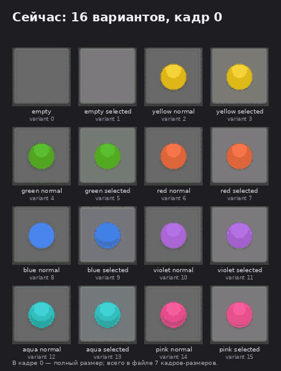
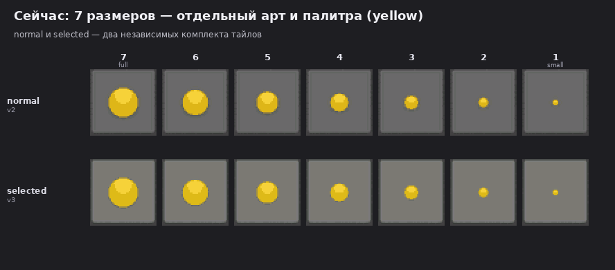
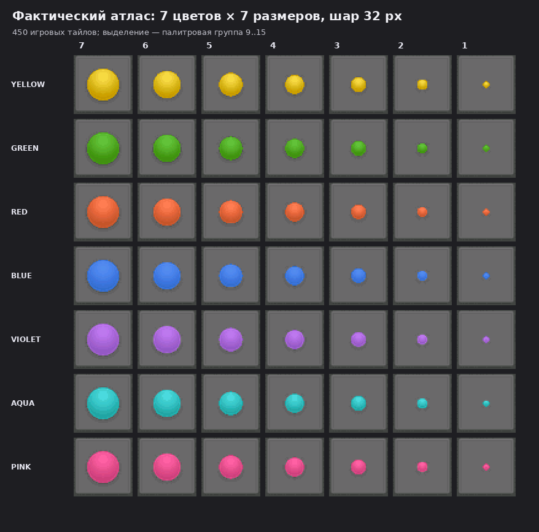
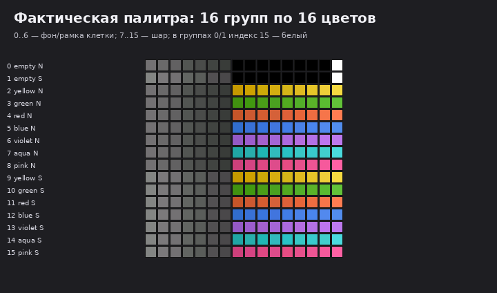
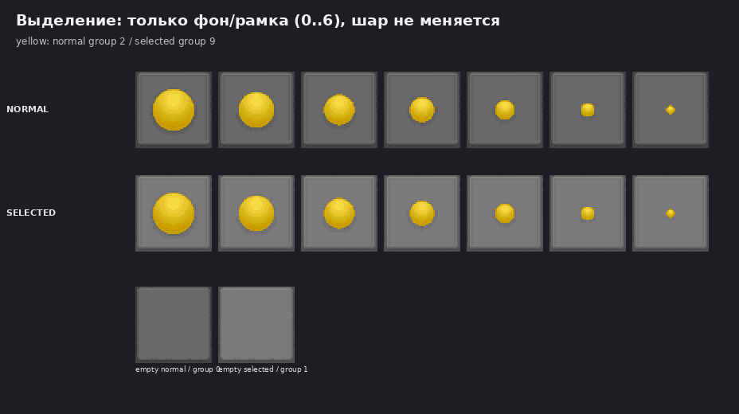
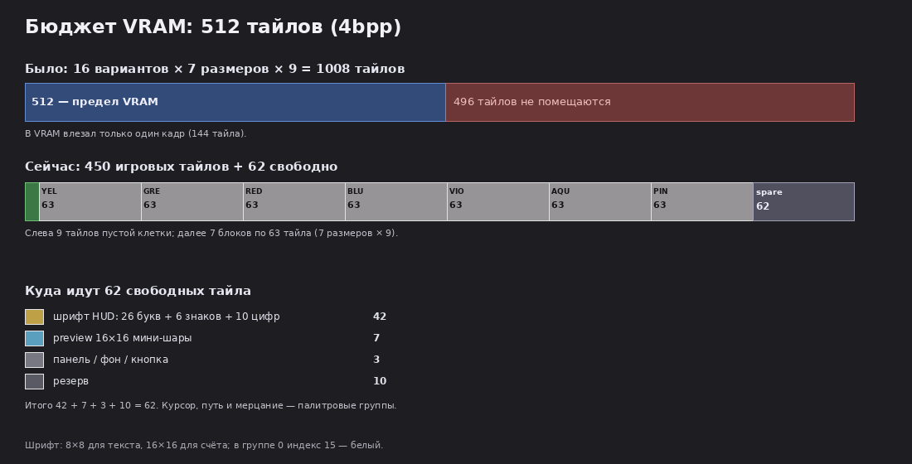
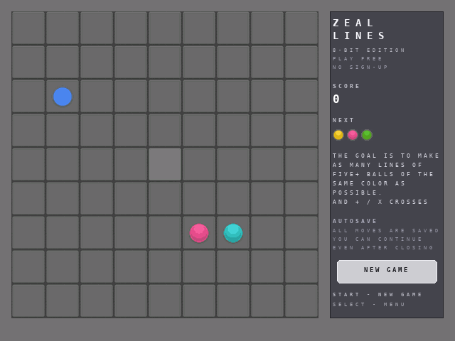
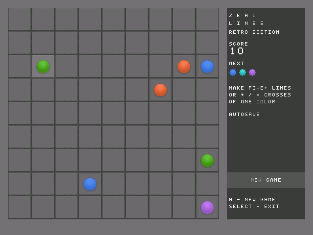
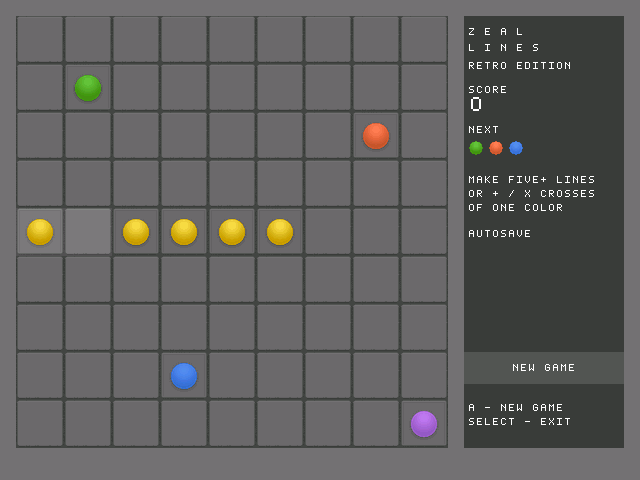
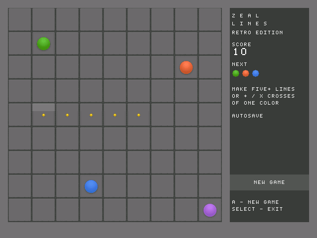

# Assets: implemented set

This document describes the implemented tileset: 512 tiles, 32-px balls, the
English sprite HUD, palette groups, preview and the disk-loaded title screen.

All images below are diagrams/mockups built from the current assets. Exact
shades may differ in the generator.

## Confirmed decisions

- **HUD in English only.** 39 font tiles: digits, uppercase Latin letters,
  punctuation, plus 7 large letters for the title. Cyrillic is not needed.
- **Score 16×16**: one digit per tile. A 16×32 score is not used.
- **Preview: separate 16×16 mini-balls**, 7 tiles (one per colour).
- **Title screen: a separate splash tileset** loaded from disk. It is not part
  of the 512-tile game atlas: VRAM is temporarily filled with the splash art,
  then the game tileset is loaded.
- **Highlighting only brightens the cell background/frame** (palette indices
  0..6). Ball shades (7..15) do not change.
- **Cell style: current L2** — rounded cells with a dotted background.
- **Ball: 32×32 px** in a 48×48 cell.
- **Game title in the HUD: `ZEAL LINES`.**
- **Autosave is labelled `AUTOSAVE`.**

## Previous layout (obsolete)

The old layout is kept here for history. It is no longer used.



The old atlas stored:

- **16 variants**: empty cell, selected empty cell, 7 colours × 2 states
  (normal/selected);
- **7 size frames** per variant;
- **9 16×16 tiles** per variant;
- **16 × 7 × 9 = 1008 tiles** in total.



The "seven frames" are not a temporary animation but **7 ball sizes**: from
full (size 7) down to small (size 1). They are used for spawning, shrinking and
pulsing.

The problem: 4bpp VRAM holds only **512 tiles**. The old layout loaded only the
first frame (144 tiles); other sizes would have to be streamed at 18 KB per
frame. In addition, normal/selected were two independent art sets, i.e.
duplication.

## Implemented set



One art set per colour/size is stored:

| Item | Tiles |
|---|---:|
| Empty cell (1 set × 9) | 9 |
| 7 colours × 7 sizes × 9 | 441 |
| **Art total** | **450** |
| Free | **62** |

450 of 512 tiles hold all 7 sizes of all colours permanently in VRAM.
Animation is just a tile-number change, with no tileset reload.

### Why 450 and not less

A ball about 32 px in diameter inside a 48×48 cell still fits in 3×3 tiles.
In 4bpp there is only one tile layer, so the cell background is baked into the
same 9 tiles as the ball. Without sprites the ball cannot be separated from the
background.

A sprite variant (one 16×16 sprite per ball) would free many tiles, but the ball
would be much smaller (16 px instead of 26 px), and 2×2 sprites for 81 balls do
not fit in the 128-sprite limit. The baked 3×3 variant preserves the scale.

## Palette and highlighting



Index layout inside each of the 16 palette groups:

- **0..6** — cell background and frame (shared grey ramp);
- **7..15** — ball shades (per colour).

Groups:

| Group | Purpose |
|---|---|
| 0 | empty cell, normal |
| 1 | empty cell, selected |
| 2..8 | 7 colours, normal cell |
| 9..15 | the same 7 colours, selected cell |

Highlighting, path and blinking are a **palette-group switch**, not a second
art set. The cursor is additionally outlined with white corner sprites: on a
crowded board a palette-only highlight looked too much like a selected ball and
the player lost the cursor. The 450 art tiles are therefore still enough for
every cell state.



The diagram shows the same yellow art with the normal and selected palette. The
selected palette only differs in entries 0..6: the cell background and frame get
brighter, the ball does not change.

## 512-tile budget



Implemented map:

| Range | Count | Purpose |
|---|---:|---|
| 0..8 | 9 | empty cell |
| 9..71 | 63 | yellow: 7 sizes × 9 |
| 72..134 | 63 | green |
| 135..197 | 63 | red |
| 198..260 | 63 | blue |
| 261..323 | 63 | violet |
| 324..386 | 63 | aqua |
| 387..449 | 63 | pink |
| 450..475 | 26 | font A-Z, 8×8 |
| 476..478 | 3 | punctuation `+ / -` |
| 479..488 | 10 | score digits, 16×16 |
| 489..495 | 7 | preview mini-balls (16×16) |
| 496..498 | 3 | background/panel/button |
| 499 | 1 | black background for GAME OVER / HIGH SCORES |
| 500..503 | 4 | cursor corners (sprites) |
| 504..510 | 7 | large title letters `Z E A L I N S` (16×16) |
| 511 | 1 | reserve |

Tile number formula for a ball:

```
tile = 9 + color * 63 + size * 9 + tile_in_cell
```

where `color` = 0..6, `size` = 0..6 (0 is full, 6 is the smallest) and
`tile_in_cell` = 0..8.

### HUD font

HUD in English only. 39 font tiles plus 7 large title letters:

- 26 uppercase Latin letters — 8×8 inside 16×16 tiles, 8 px sprite advance;
- 3 punctuation marks (`+ / -`) — 8×8;
- 10 digits — 16×16 for the score (one digit per tile);
- 7 large letters `Z E A L I N S` — 10×14 inside 16×16 tiles, 16 px advance.

The goal text uses `FIVE+` rather than `5+`: the large 16×16 digits are intended
for the score only, and would overlap in 8-px text.

The large `ZEAL` / `LINES` title is drawn with tiles 504..510 at a 16 px advance.
The `GAME OVER` and `HIGH SCORES` screens use the regular 8-px font; their
digits use a 16 px advance because the digit tiles are 16×16.

The font is custom, 5×7 pixels; score digits are scaled 2× into 16×16.
No TTF is used in the game.

### Preview

The preview uses separate 16×16 mini-balls: 7 tiles, one per colour. They are
drawn as sprites; index 0 is transparent, so the panel background shows through.

### Title screen / splash

Implemented in `src/splash.c`. The title screen is not part of the 512-tile game
atlas. It is loaded separately from disk, as in `zeal-xonix`:

| File | Contents |
|---|---|
| `assets/splash.zts` | 4bpp splash tileset, up to 512 tiles (65,536 bytes) |
| `assets/splash.ztp` | splash palette (16 RGB565 colours) |
| `assets/splash.ztm` | tilemap: 30 layer-0 rows + 30 layer-1 attribute rows |

Flow:

1. Open the files next to the binary; if missing, skip the splash and start the
   game with a warning.
2. `gfx_palette_load()` — splash palette.
3. `gfx_tileset_load_none()` in chunks — splash tileset.
4. `gfx_tilemap_load()` — 40 columns × 30 rows for layer 0 and layer 1.
5. `gfx_enable_screen(1)`, fade-in (33 frames), wait for any key or 25 seconds,
   fade-out (32 frames).
6. Load the game tileset and palette, then show the game.

The splash can be a static picture with a `PRESS START` caption. If a main menu
(`NEW GAME`, `HIGH SCORES`, `SETTINGS`) is needed afterwards, it is drawn with
the game HUD font on a separate tilemap screen.

The splash palette is 16 colours (as in `zeal-xonix`). Layer-1 attributes in
`.ztm` select the palette group of each tile.

### Panel and background

Solid tiles and service elements:

- `TILE_BACKGROUND` 496 — screen background, index 0;
- `TILE_PANEL` 497 — HUD panel, index 6;
- `TILE_BUTTON` 498 — `NEW GAME` button, index 3;
- `TILE_BLACK` 499 — black background of the score screens, index 7;
- `TILE_CURSOR` 500..503 — four white cursor corners, transparent background;
- `TILE_TITLE` 504..510 — large `ZEALINS` letters for the HUD title.

### GAME OVER and HIGH SCORES screens

Both screens are built from existing tiles, no new ones are required:

- frame and background — `TILE_BUTTON` / `TILE_PANEL` / `TILE_BLACK`;
- colour divider — 7 `TILE_PREVIEW` mini-balls drawn as sprites;
- headings — the regular 8×8 font with a wider sprite advance;
- score — large 16×16 digits;
- new-record marker — a yellow mini-ball and the `NEW` label.

### Reserve

1 tile. Path, pre-highlight and cursor do not use it: the first two use palette
groups, the cursor uses four corner sprites.

## Game screen (English)

The layout is based on `sample-game-field.png`: a 9×9 board on the left and a
panel on the right. All in-game typography is **English only**.



Coordinates in 640×480:

| Element | Position |
|---|---|
| 9×9 board, 432×432 | x=16, y=16 |
| Panel 160×432 | x=464, y=16 |
| Gap | 16 px |
| Margins | 16 px left/right, 16 px top, 32 px bottom |

Panel contents (implemented):

- `ZEAL` / `LINES` — title (large letters);
- `RETRO EDITION` — subtitle;
- `SCORE` and the number (16×16 digits);
- `NEXT` and three mini-balls;
- goal text: `MAKE FIVE+ LINES`, `OR + / X CROSSES`, `OF ONE COLOR`;
- `AUTOSAVE`;
- a `NEW GAME` button;
- hints `A - NEW GAME`, `SELECT - EXIT`.

The wording is deliberately "8-bit arcade", not a web landing page: the game is
not online and does not have sign-up.

### How it fits into tiles

- Title: 16 px advance, two lines `ZEAL` and `LINES`.
- Body text: **8×8 glyphs in 16×16 tiles, 8 px advance**. This gives 19
  characters per line in the 160 px panel and fits the English text above.
- This text uses the **sprite HUD** (ZGDK `hud_sprite_*`): sprites can advance
  by 8 px, a plain tilemap only by 16 px.
- The panel and button are solid tiles; text and mini-balls are sprites.
- Cursor, path and match preview use palette groups, no new tiles; the cursor
  additionally uses four white corner sprites.

### Score

Score is **16×16**: one digit per tile. A 16×32 score is not used. The atlas
reserve is 1 tile.

## In-game screen



This is an actual emulator screenshot. The HUD is built from sprites:

- title and text — 8×8 glyphs at 8 px advance (title: large 16×16 glyphs);
- score — 16×16 digits;
- preview — three separate 16×16 sprites;
- panel and button — solid tiles.

## Animations and highlighting (implemented)



The screenshot shows a yellow ball selected on the left and the cursor on an
empty cell on the right. The line cells that would be removed are highlighted
through the background; the path to the target is highlighted as empty cells.



When clearing, balls shrink from full size to the smallest and are then
removed. The score updates and the move is stored by autosave.

Implementation in `play.c`:

- the main loop waits with `msleep(16)` (vblank pacing is avoided because it
  hangs headless emulator sessions);
- movement — one cell every 3 frames;
- shrink — sizes 0..6, 5 frames per size;
- spawn — sizes 6..0, 5 frames per size;
- selected-ball pulse — 0↔1 every 30 frames;
- preview blink — every 16 frames;
- the path is built by `game_path()`;
- match preview — `game_match_preview()` without changing the board;
- removal — `game_remove_mark()` with scoring.

## Animation summary

| Animation | How it works | Extra tiles |
|---|---|---|
| Ball spawn | size 6 → 0 (small → full) | 0 |
| Shrink | size 0 → 6, then empty cell | 0 |
| Selected-ball pulse | 0 ↔ 1 by size, or 2+c ↔ 9+c by palette | 0 |
| Path movement | step by step, two cells updated | 0 |
| Path highlight | empty cell with group 1 | 0 |
| Match preview | normal/selected group blink | 0 |
| Particles | not needed; shrink + palette flash | 0 |

## Generator

`tools/prepare_assets.py`:

1. Downloads the source PNGs from L2.
2. Quantizes the cell background into 7 indices (0..6) and each ball colour
   into 9 shades (7..15).
3. Builds one art set per colour/size: 49 sets × 9 tiles = 441.
4. Adds the empty cell — 9 tiles.
5. Generates 26 letters and 3 punctuation marks at 8×8, then 10 digits at 16×16.
6. Generates 7 preview mini-balls at 16×16.
7. Generates solid tiles: background, panel, button, black.
8. Generates 4 cursor corner tiles.
9. Generates 7 large title letters (16×16).
10. Writes exactly 512 tiles = **65,536 bytes** and a 256-colour RGB565 palette.
11. Updates `src/assets_generated.c/h` with the constants
    `TILE_EMPTY`, `TILE_BALL_BASE`, `TILE_COLOR_STRIDE`, `TILE_SIZE_STRIDE`,
    `TILE_FONT_LETTERS`, `TILE_FONT_PUNCT`, `TILE_FONT_DIGITS`, `TILE_PREVIEW`,
    `TILE_BACKGROUND`, `TILE_PANEL`, `TILE_BUTTON`, `TILE_BLACK`, `TILE_CURSOR`,
    `TILE_TITLE`, `TILE_RESERVE`.

The loader in `render.c` reads 65,536 bytes with a 32-bit counter; the last
chunk starts at 63,488.

The generator also writes `assets/atlas_preview.png`, a human-readable atlas
preview. It is a development artifact and is not needed for the build.

## Open questions

1. ~~Large title~~ — implemented: 7 large glyph tiles (504..510).
2. Splash palette: 16 colours are used, as in `zeal-xonix`.
3. The game starts right after the splash (no main menu).
4. Licence of the original L2 sprites.
